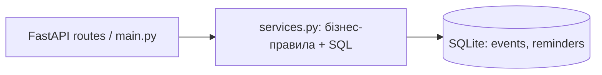
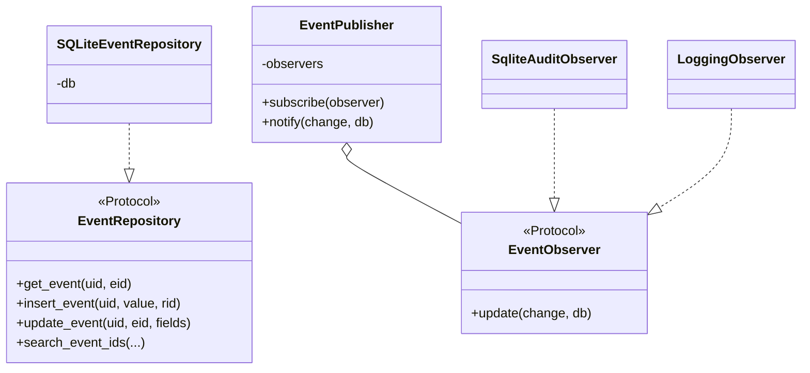

# Лабораторна робота №12 — EventReminder

Тема: Вдосконалення наявної архітектури проєкту шляхом рефакторингу та впровадження дизайн-патернів.

## Чому саме ці патерни?

1. **Repository (архітектурний патерн)**. У початковому `backend/app/services.py` бізнес-правила, транзакції та SQL були в одному модулі. Тепер SQL для CRUD подій, нагадувань, повторень, винятків та пошуку знаходиться в `app/repositories.py`. Контракт `EventRepository` (Protocol) описує потрібні операції, `SQLiteEventRepository` реалізує їх для SQLite. Це дозволяє тестувати бізнес-логіку окремо й замінити БД без переписування сервісів.

2. **Observer (поведінковий GoF-патерн)**. Після створення/редагування/видалення події кілька незалежних підсистем можуть реагувати на зміну. Раніше такого механізму не було. `app/observers.py` містить `EventPublisher`, інтерфейс `EventObserver` та двох підписників: `SqliteAuditObserver` (збереження історії в таблицю `event_audit`) і `LoggingObserver` (логи без особистого тексту події). Подія публікується **після коміту основної транзакції**; збій спостерігача не повертає помилку клієнту після успішного CRUD.

## Структура змін

```text
backend/
  app/
    repositories.py          # НОВИЙ: Repository, SQLiteEventRepository
    observers.py             # НОВИЙ: Observer, Publisher, два обробники
    services.py              # ЗМІНЕНО: сервіс делегує SQL репозиторію, публікує події
    database.py              # ЗМІНЕНО: таблиця event_audit (CREATE IF NOT EXISTS)
    main.py                  # ЗМІНЕНО: пошук через Repository; маршрути незмінні
  tests/
    test_lab12_patterns.py    # НОВИЙ: 4 тести патернів
```

## UML / архітектура до змін



## UML / архітектура після змін



Потік: `main.py -> services.py -> EventRepository -> SQLite`; після успішного коміту: `services.py -> EventPublisher -> AuditObserver / LoggingObserver`.

## Як встановити у свій проєкт (Windows PowerShell)

```powershell
cd ..
git diff main -- backend/app
# Перевірити внесені зміни
git add backend/app backend/tests/test_lab12_patterns.py LAB12_README.md
git commit -m "Lab 12: refactor EventReminder using Repository and Observer"
git push -u origin lab12-refactoring
```

Порівняти архітектуру можна у GitHub через pull request `lab12-refactoring -> main` (не обов'язково одразу зливати гілку).

## Зображення та скриншоти для звіту

- Початковий стан і дерево модулів.
- `git switch -c lab12-refactoring` і початковий `pytest -v`.
- UML `lab12_uml_before.png` / `lab12_uml_after.png`.
- Код `EventRepository` / `EventPublisher`.
- Результат `pytest -v` після рефакторингу (**22 passed** за перевіркою пакета у тестовому середовищі).
- `git diff main -- backend/app` та посилання на репозиторій.

## Переваги / недоліки

**Repository:** менше SQL у сервісах, ізольовані запити, чіткіший розподіл відповідальності. Ціна: додатковий модуль і непряма інтерпретація доступу до даних.

**Observer:** нові реакції можна підключати без переписування CRUD; журнал дій переживає видалення події. Ціна: з'являється додаткова таблиця; у production потрібні контроль журналу й надійна черга, якщо сповіщення стануть критичними. Для лабораторної Observer синхронний із обробкою помилок, тож це не гарантована доставка повідомлень.

**Безпека:** JWT-ключі, `.env`, користувацькі SQLite-файли в ZIP не включені.
